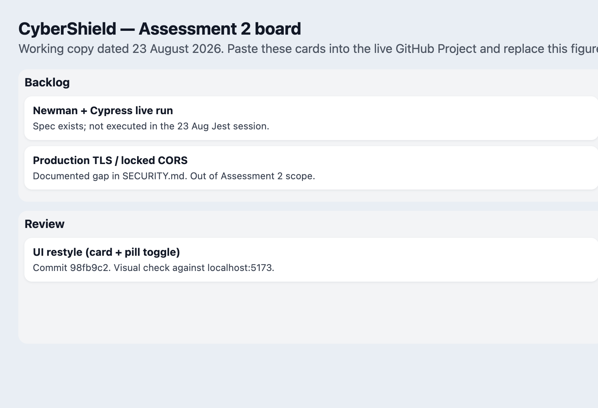
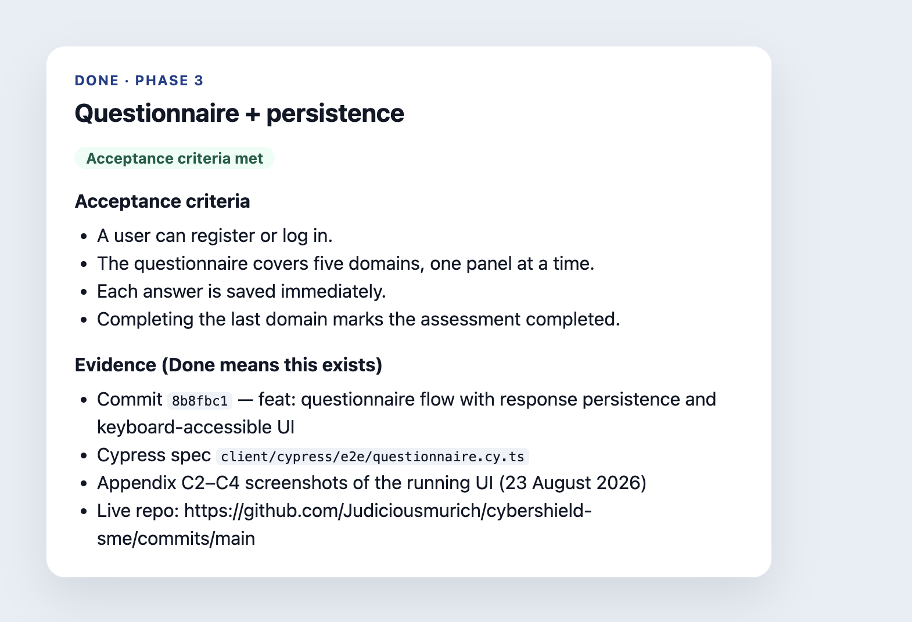
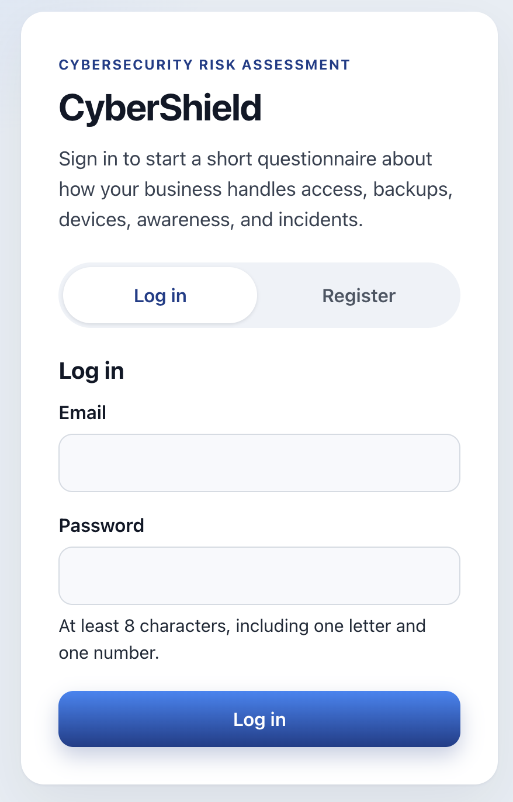
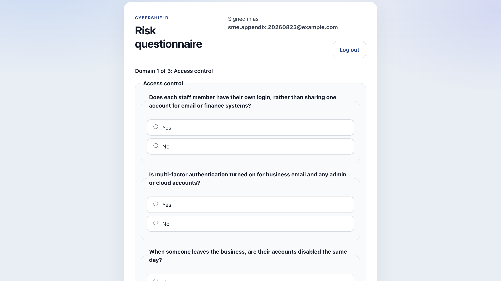
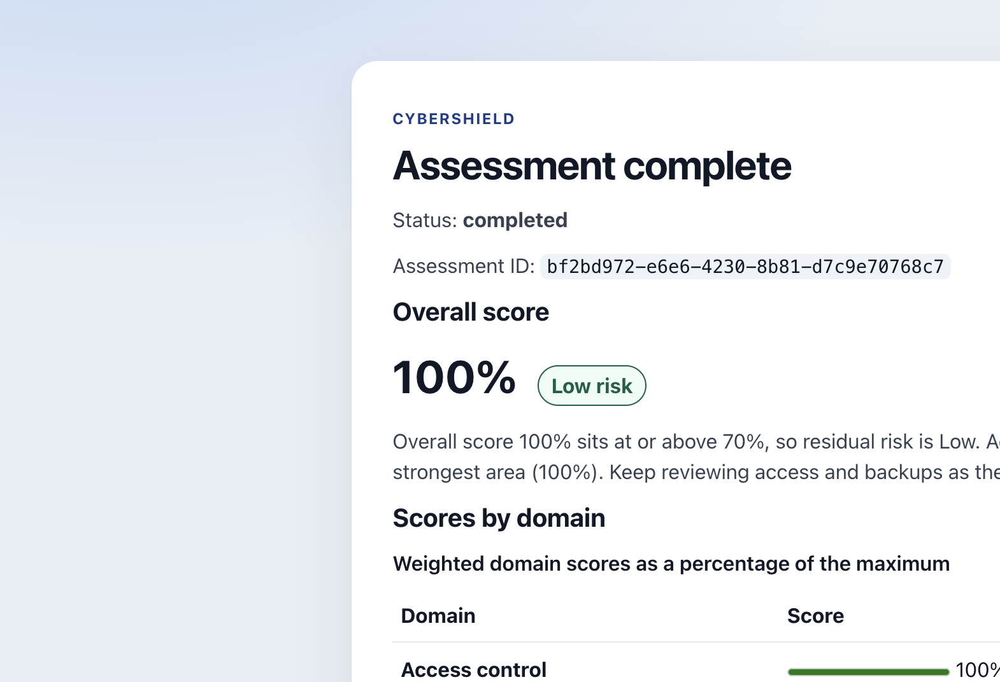
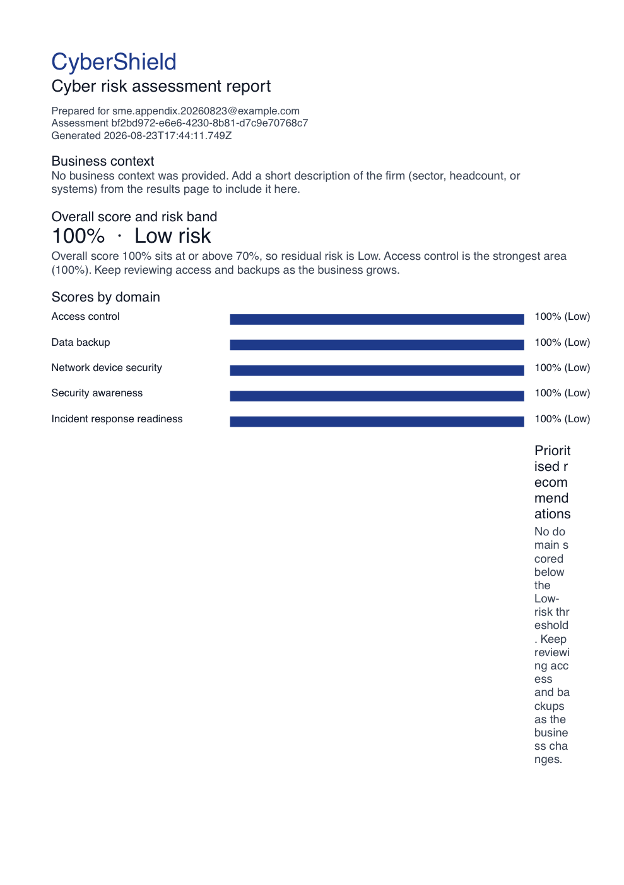
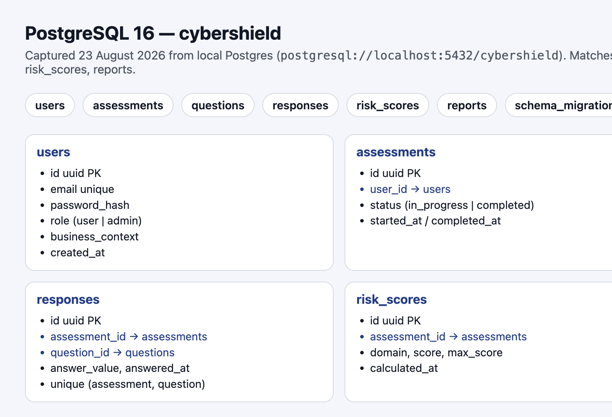
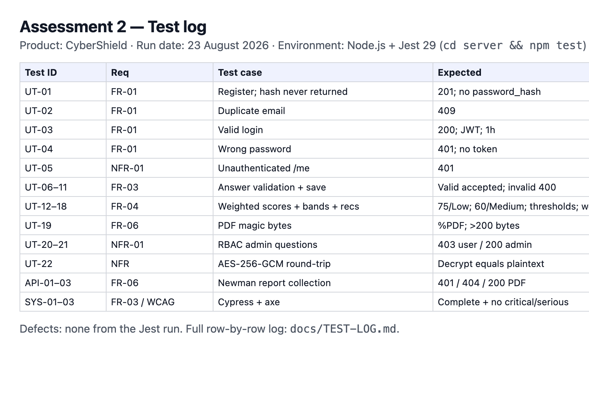
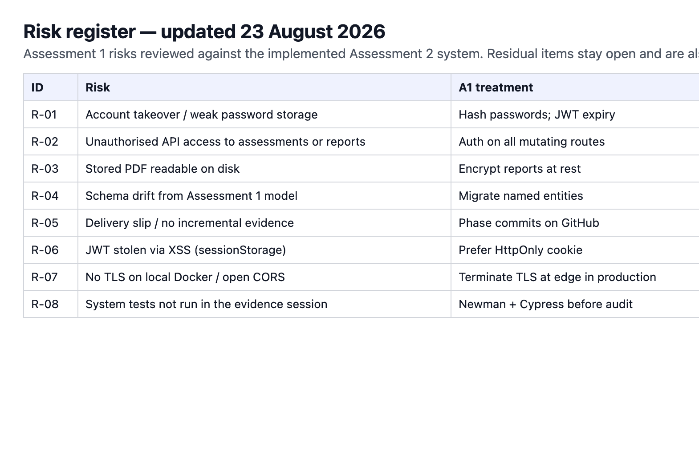

# Assessment 2 appendices — CyberShield

**Product:** CyberShield  
**Evidence date:** 23 August 2026  
**Approved project repo:** [https://github.com/Judiciousmurich/cybershield-sme](https://github.com/Judiciousmurich/cybershield-sme)  
**Commit history (live record):** [https://github.com/Judiciousmurich/cybershield-sme/commits/main](https://github.com/Judiciousmurich/cybershield-sme/commits/main)

Screenshots in `images/` were captured from the running local stack (`http://localhost:5173` + Postgres `cybershield`) on 23 August 2026. Paste this file into the report appendices (or File → Print in preview). Keep the GitHub and project-board **links** in the 1,500-word body — the pictures are backup.

---

## Pointer sentences (paste into the body, one line each)

- Appendix B shows the Week 6 backlog board. Replace the working-copy figure with the live GitHub Project URL once that board exists.
- Appendix C shows the running system, PDF output, and PostgreSQL schema. Implementation history is at [https://github.com/Judiciousmurich/cybershield-sme/commits/main](https://github.com/Judiciousmurich/cybershield-sme/commits/main).
- Appendix D is the test log from 23 August 2026 (`docs/TEST-LOG.md`).
- Appendix E is the risk register updated on 23 August 2026 against the implemented system and `SECURITY.md`.

---

## Appendix B — Project board (§3.2)

Working copy dated 23 August 2026. This is **not** yet a live GitHub Project. Create a board named `CyberShield — Assessment 2` with columns Backlog / In Progress / Review / Done, paste the cards from `board.html`, then replace Figure B1 with a screenshot of **that** URL.

### Figure B1 — Full board

### Figure B2 — Opened Done card (acceptance criteria + evidence)

Lecturers check that Done means evidence exists. This card is Phase 3.

---

## Appendix C — Technical development (§3.4)

Captured from `http://localhost:5173` on 23 August 2026 using a demo SME account. The live source record is the GitHub commit list, not screenshots of code.

### Figure C1 — Login screen

### Figure C2 — Questionnaire (Domain 1 of 5)

### Figure C3 — Questionnaire mid-flow (Domain 2 of 5)

### Figure C4 — Results / scoring

Overall score **100%**, band **Low**, with per-domain scores. Status: `completed`.

### Figure C5 — PDF report output

Preview of the downloaded report (`images/C5-report.pdf`, starts with `%PDF`).

### Figure C6 — Database schema (Assessment 1 model on disk)

Tables present in local PostgreSQL 16 (`cybershield`): `users`, `assessments`, `questions`, `responses`, `risk_scores`, `reports`, `schema_migrations`. Foreign keys match Assessment 1: users → assessments → responses / risk_scores / reports.

### Commit history (required live link)

Work was delivered as sequential commits on `main` (no pull-request series). The lecturer should open:

**https://github.com/Judiciousmurich/cybershield-sme/commits/main**

| Date | Hash | Message |
| --- | --- | --- |
| 2026-08-23 | `98fb9c2` | style: refresh screens with card layout and softer form styling |
| 2026-08-23 | `b4a88e4` | docs: Assessment 2 test log from the Jest run |
| 2026-08-22 | `ae160a6` | chore: security hardening and accessibility audit fixes |
| 2026-08-22 | `5061e63` | feat: downloadable PDF risk assessment report |
| 2026-08-22 | `fcb5286` | feat: domain-weighted scoring engine and recommendation mapping |
| 2026-08-22 | `8b8fbc1` | feat: questionnaire flow with response persistence and keyboard-accessible UI |
| 2026-08-22 | `f75cc8c` | feat: JWT authentication with bcrypt hashing and rate limiting |
| 2026-08-22 | `af573cd` | feat: database schema and seed data for questions |
| 2026-08-22 | `337e85c` | chore: initial monorepo structure with docker-compose |

---

## Appendix D — Testing (§3.5)

Full row-by-row log: [docs/TEST-LOG.md](../TEST-LOG.md).

**Run date:** 23 August 2026  
**Command:** `cd server && npm test`  
**Result:** 7 suites, 22 tests, 0 failures.

### Figure D1 — Test log

| Test ID | Req | Status | Defect |
| --- | --- | --- | --- |
| UT-01–UT-22 | FR-01, FR-03, FR-04, FR-06, NFR-01 | Pass | — |
| API-01–API-03 (Newman) | FR-06 | **Not executed** | — |
| SYS-01–SYS-03 (Cypress + axe) | FR-03 / WCAG | **Not executed** | — |

No failed-test defect was raised from the Jest run. Newman and Cypress were not executed in this evidence session; that gap is also risk R-08. Do not mark those rows Pass.

---

## Appendix E — Risk register (§3.6)

Updated 23 August 2026 against the implemented Assessment 2 system. Residual items stay open and are listed in [SECURITY.md](../../SECURITY.md).

### Figure E1 — Updated register

| ID | Risk | A2 status (23 Aug 2026) | Evidence |
| --- | --- | --- | --- |
| R-01 | Account takeover / weak password storage | Mitigated | bcryptjs; JWT 1h; UT-01–UT-04 |
| R-02 | Unauthorised API access | Mitigated | `requireAuth` + ownership; UT-05, UT-20 |
| R-03 | Stored PDF readable on disk | Mitigated | AES-256-GCM; UT-22 |
| R-04 | Schema drift from Assessment 1 | Mitigated | migrations 001 + 002; Figure C6 |
| R-05 | Delivery slip / no incremental evidence | Mitigated | GitHub `main` history |
| R-06 | JWT stolen via XSS (`sessionStorage`) | Open / residual | SECURITY.md |
| R-07 | No TLS on local Docker / open CORS | Open / residual | Local HTTP only |
| R-08 | System tests not run in the evidence session | Open | API-01–03, SYS-01–03 Not executed |

---

## How to drop this into Word

1. Open `ASSESSMENT-2-APPENDIX.md` in VS Code preview or Typora.
2. Copy each appendix heading + figure into your report **Appendices** section (not the 1,500 words).
3. After you create the GitHub Project, replace Figure B1 with a screenshot of the live board URL and put that URL in the body pointer.
4. If the repo is private, add the lecturer as a collaborator so the commit link opens.
